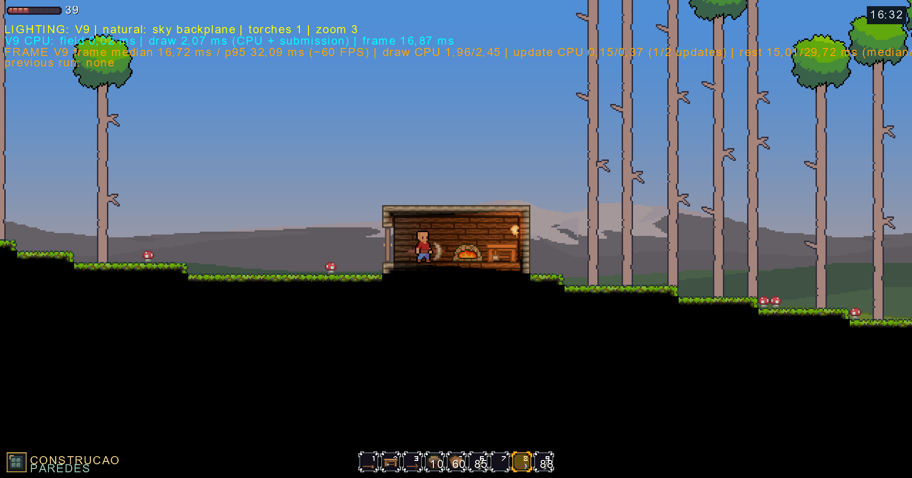
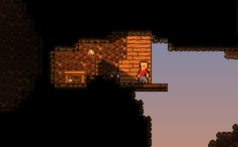

# Ny’vorn — Echoes of the Hollow Star

**Um sandbox 2D de exploração, construção e sobrevivência em um mundo marcado pelo horror cósmico.**

Em Ny’vorn, a superfície é apenas o começo. Sob o terreno existe o **Tissue**, uma rede planetária que conecta matéria, memória e transformação. Explorar as profundezas significa descobrir recursos, enfrentar ameaças e encontrar sinais de algo antigo que continua influenciando o mundo.

O projeto combina a liberdade de um sandbox com uma narrativa ambiental: a história se revela pela exploração, pelos vestígios de civilizações e pelo comportamento do planeta.

## O mundo de Ny’vorn

A proposta narrativa acompanha **Ekko**, cuja chegada a um planeta aparentemente comum o coloca diante de uma rede subterrânea e de uma presença selada nas profundezas: **Smiley**. Ruínas, símbolos e alterações no Tissue apontam para um passado que o jogador precisa reconstruir.

A descoberta acompanha a liberdade de minerar, construir, combater e desenvolver equipamentos. O mistério cresce conforme o jogador aprende a ler o mundo.

## Imagens do projeto

| Superfície e construção | Cavernas e exploração |
| :---: | :---: |
|  |  |
| Paisagem, personagem e uma construção no mundo. | Exploração subterrânea, iluminação e atmosfera. |

<!-- Para atualizar os prints, substitua as imagens em Docs/Images/.
Essa pasta fica fora de screenshots/, que é ignorada pelo Git. -->

## A experiência

- **Explore um mundo procedural:** descubra a superfície, cavernas e camadas subterrâneas em mundos gerados por seed.
- **Transforme o terreno:** mine recursos, coloque blocos e construa com portas, plataformas, móveis e estações de criação.
- **Prepare-se para sobreviver:** gerencie inventário e hotbar, crie itens e enfrente inimigos.
- **Observe um ambiente em movimento:** ciclos de dia e noite, duas luas, chuva, eclipse e simulações de água, areia, grama e umidade compõem o cenário.
- **Descubra o Tissue:** uma rede subterrânea com geração, revelação, pulsos, mutação e propagação conecta os sistemas do mundo à identidade do jogo.

## Estado do desenvolvimento

Ny’vorn está em desenvolvimento, com uma base jogável que reúne geração de mundos, mineração, construção, combate, crafting, inventário, minimapa e salvamento de mundo e jogador.

A iluminação V9 é o pipeline padrão do gameplay, com luz do céu, iluminação de tochas e tratamento das camadas de superfície e cavernas.

A visão narrativa inclui a história de Ekko, Smiley, civilizações perdidas e a influência do Tissue. O arco completo da história e as expansões descritas na lore representam a direção do projeto; sua implementação acompanha a evolução dos sistemas.

## Tecnologias

| Área | Base utilizada |
| :--- | :--- |
| Linguagem | C# |
| Plataforma | .NET 8 |
| Framework de jogo | MonoGame DesktopGL 3.8 |
| Conteúdo | MonoGame Content Pipeline, sprites, shaders e dados em JSON |
| Sistemas próprios | Geração procedural, simulação do mundo, Tissue e iluminação |

## Executar localmente

Com o **SDK do .NET 8** instalado, execute a partir da raiz do repositório:

```powershell
cd Nyvorn
dotnet tool restore
dotnet restore
dotnet run
```

O projeto inclui um manifesto de ferramentas do MonoGame em `Nyvorn/.config/dotnet-tools.json`. O conteúdo é compilado pelo pipeline do MonoGame durante o build.

## Conheça mais do projeto

- [Lore canônica e visão narrativa](Docs/auditoria-2026-09/Design/Lore/NYVORN_BIBLIA_v2_COMPLETA.md)
- [Arquitetura e funcionamento do Tissue](Docs/TissueArchitecture.md)
- [Fluxo da arquitetura do jogo](Docs/Arquitetura/ARCHITECTURE_FLOW.md)
- [Regras de arquitetura](Docs/Arquitetura/ARCHITECTURE_RULES.md)
- [Iluminação V9: promoção ao gameplay padrão](Docs/LightingV9/V9_PROMOCAO_PADRAO.md)
- [Comandos do console de desenvolvimento](Docs/ConsoleCommands.md)

Os documentos em `Docs/Arquivos/` e a auditoria de setembro preservam planos e registros históricos. Para o estado de cada sistema, consulte também sua documentação mais recente e o código atual.
